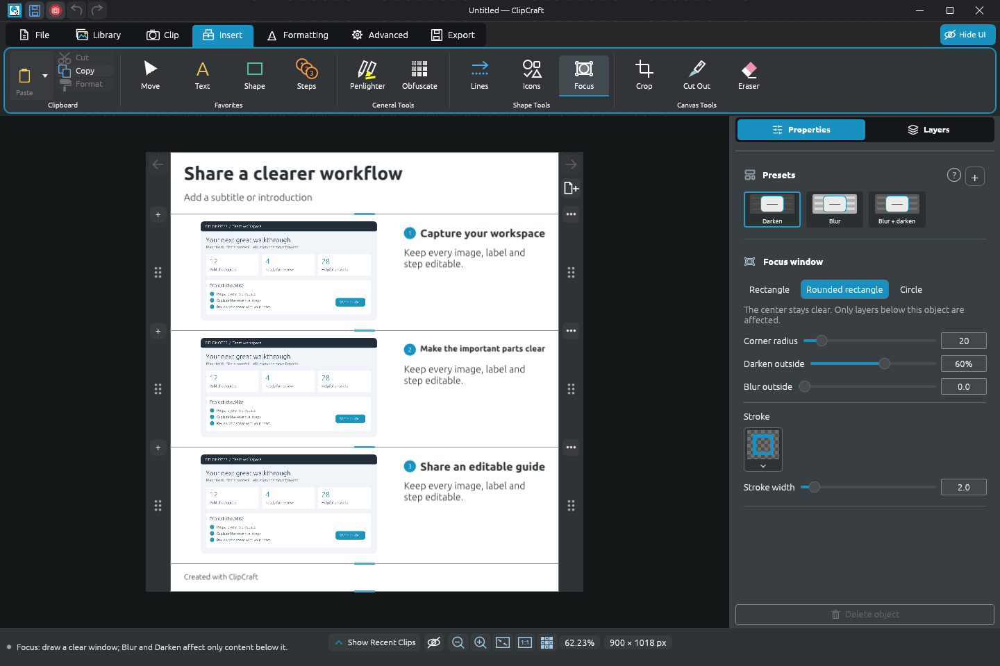
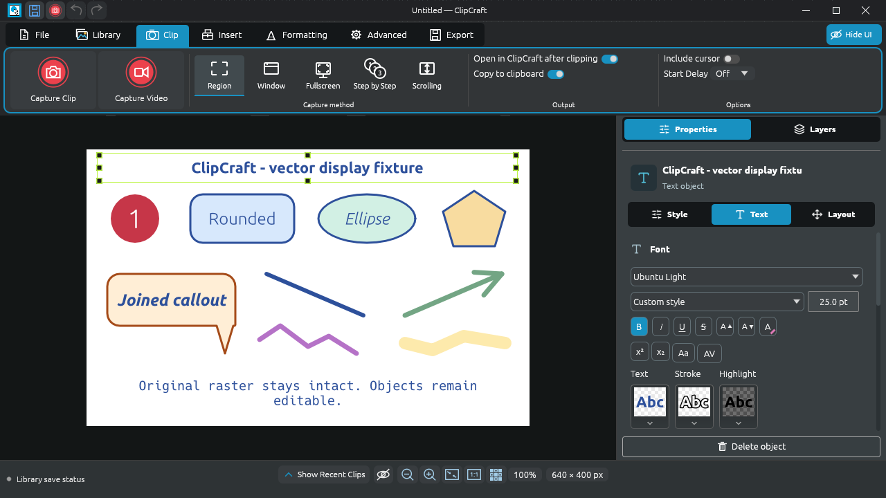
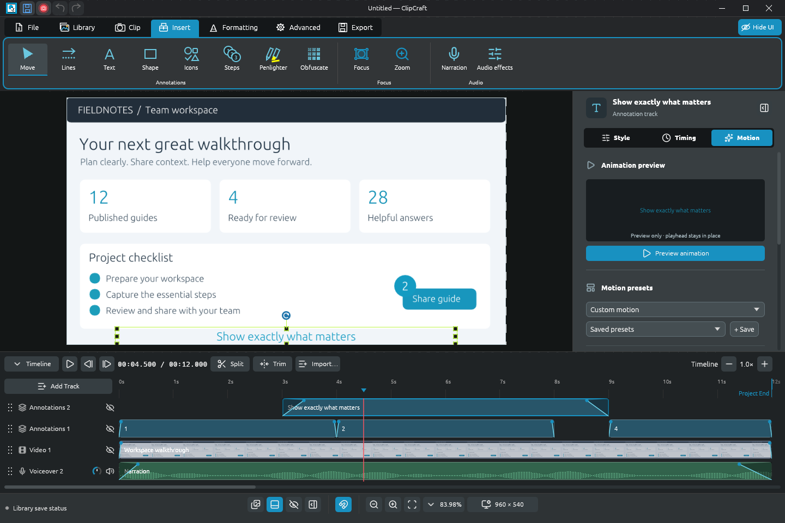
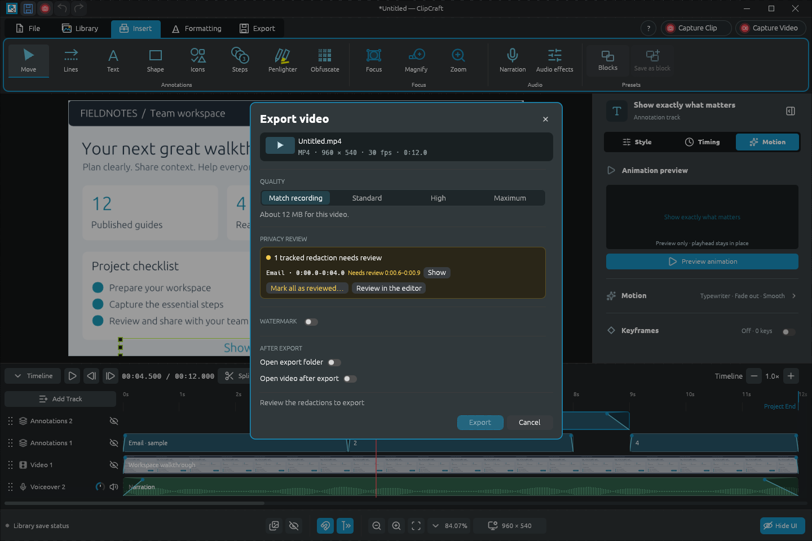
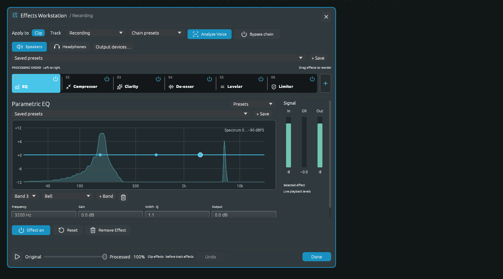
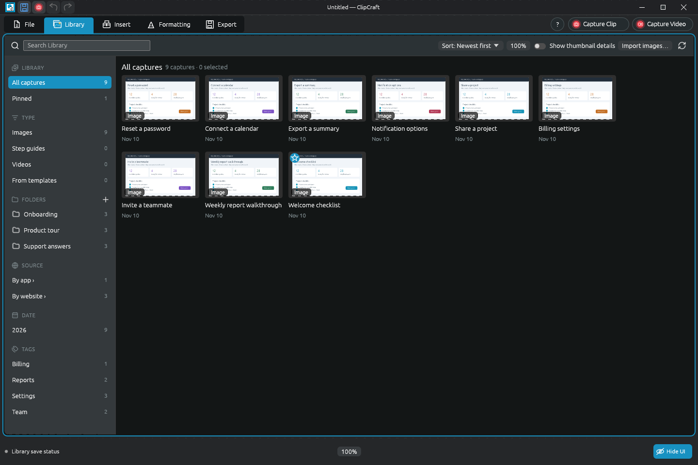
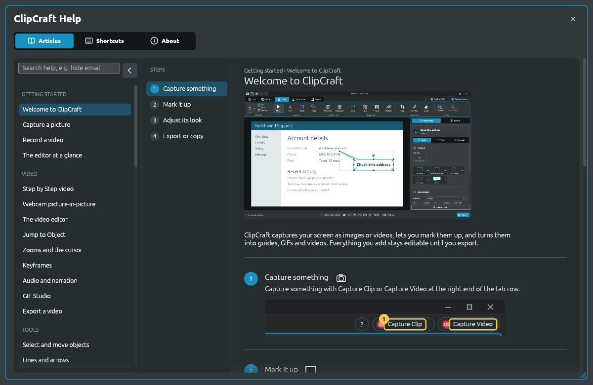

# ClipDesigner

**Capture a moment. Explain a workflow. Make it editable.**

ClipDesigner brings screen capture, step-by-step guides and video editing into one
local Windows workspace. Capture your screen, point out what matters, add narration,
and share a polished image, PDF, GIF or video. Everything stays on your PC, and no
ClipDesigner account is required.

**[Download 1.0.0-beta.3](https://github.com/pashiadesigns/ClipCraft/releases/tag/v1.0.0-beta.3)**
· [Install & storage locations](docs/installing.md) · [Build from source](docs/building.md)
· [Known limitations](#beta-notes)

Windows 10/11, x64. Choose the **MSI installer** or extract the **portable ZIP**.
This beta is unsigned. The source is available under Apache-2.0 with retained
third-party notices. Older development project formats are not supported.

> **New name, same app.** ClipDesigner was called ClipCraft through 1.0.0-beta.3,
> and that release still installs and appears as ClipCraft. The next release
> installs as ClipDesigner, replaces the ClipCraft installation and moves your
> Library, settings and presets from `%LOCALAPPDATA%\ClipCraft` to
> `%LOCALAPPDATA%\ClipDesigner` the first time it starts.

## Who uses ClipDesigner?

| **Casual users** | **Power users** |
| --- | --- |
| **Who they are:** coordinators, analysts, support staff, team leads, or whoever on the team gets asked "how do I…?" | **Who they are:** trainers, instructional designers, documentation teams, product marketers and tutorial creators. |
| **How they work:** a few times a week, a few minutes at a time. Each capture is a one-off answer. | **How they work:** ClipDesigner stays open for hours, and they produce a series of material, not one-offs. |
| **What they make:** • Point out a button for a colleague: capture, add an arrow, paste into chat • Turn "how do I submit an expense?" into a six-step PDF guide • Hide a customer name before sending a screenshot • Record a 90-second narrated walkthrough of where a setting lives • Find last Tuesday's capture in the Library | **What they make:** • A 40-page onboarding manual with sections, headers, footers and page numbers • Product tutorials with webcam, cursor-following zooms and animated callouts • Clean narration with EQ, compression and de-essing • GIF loops for release notes and social posts • Videos recorded on live systems, with every tracked redaction reviewed before publishing |
| **What ClipDesigner gives them:** a capture hotkey, copy to clipboard, presets that look good with no settings, guide templates, Find Sensitive Info, and F1 Help on any control. | **What ClipDesigner gives them:** custom presets, palettes and Blocks, Page Setup, multitrack video with keyframes, the Effects Workstation, GIF Studio, and Library folders and tags. |
| **Where it ends up:** chat messages, email, support tickets and wiki pages. | **Where it ends up:** training courses, help centers, video channels, release notes and printed manuals. |

*Most power users start as casual users. It's the same app and the same project files, so the depth is there when you need it.*

## What's new

**Beta 3** fixes beta 2: hand cursors appear only on rotation handles and the
middle curve node, and stay visible while you drag; one Callout preset group with
box, rounded, oval and cloud styles; clearer Ellipse and Freehand blur presets;
and Free perspective corners that follow the pointer for the whole drag.

**Beta 2** was a large update: tracked video redaction with review, built-in
illustrated Help, keyframes, GIF Studio, webcam picture-in-picture, filters and
borders, Preferences, a clearer Library and a simpler ribbon. See the
[release notes](https://github.com/pashiadesigns/ClipCraft/releases) for details.

## Images that explain

- **Annotate:** lines and arrows, rich text, ready-made shapes, box, rounded, oval
  and cloud callouts, Icons, numbered Steps and Penlighter. Every drawing tool
  starts from a preset, and you can save your own.
- **Direct attention:** **Focus** keeps an area clear while blurring or darkening
  everything beneath it. **Magnify** adds a magnified callout of any detail.
  Labels and arrows stay sharp above both.
- **Refine pictures:** crop with fixed ratios, Cut Out with shaped edges, a soft or
  hard-edged Eraser, perspective, filters, color, borders and edges. Originals
  stay editable; nothing is flattened until you export.
- **Lay out:** alignment, distribution, layers, groups, snapping to objects and an
  optional grid, color palettes, and reusable **Blocks** of objects.
- **Build guides:** templates, sections, multipage layouts, Page Setup with physical
  page sizes, margins, headers and footers, numbering, bleed and crop marks.

Export PNG, JPEG or PDF, print from Windows, add a watermark, or save an editable
`.iclip` project. SVG and EPS files import as editable pictures.

## Capture the way you work

**Capture Clip** and **Capture Video** sit at the right end of the tab row. Capture
a region, a window or the full screen; stitch a scrolling region; or record your
clicks as an editable **Step by Step** guide. Choose a start delay and whether to
open the editor or copy to the clipboard, or capture directly from a hotkey or the
system tray. Every capture is saved to your local Library.

## Video with context

Record your screen or a window with microphone and system audio, then keep editing
in the same workspace.

- **Recorded cursor:** adjustable smoothing and click marks, and zooms that can
  follow the cursor.
- **Webcam picture-in-picture** that starts with the first screen frame and skips
  pauses.
- **Tracks** for video, pictures, audio, narration and annotations. Trim, split,
  link and move clips together, edit several clips at once, and Alt+drag to copy.
- **Animate** text, shapes, arrows, Icons and Steps with entrance and exit presets,
  or with keyframes for position, size and color (Smooth, Linear or Hold).
- **Zoom** and **Focus** objects affect only the tracks beneath them. **Jump to
  Object** finds any object on the timeline.
- **New video from pictures,** with each picture fading into the next.
- **GIF Studio** cuts short loops from any part of the timeline.

Export MP4 with a quality preset and a size estimate, or save an editable `.vclip`
with its media folder.

## Privacy review before you share

**Find Sensitive Info** reads images and videos on your PC and suggests what to
hide. In a video, redactions follow text as it moves or scrolls; uncertain
moments are flagged, and **Export video** lists every redaction that still needs
your review, with Show and Previous/Next to step through them. Exported redactions
remove the covered content; your project keeps the originals.
[How detection works and what it can miss.](docs/security-model.md)

## Narration and audio

Record and review takes, choose input and output devices, and monitor through
headphones. The Effects Workstation provides an ordered, editable chain of
**parametric EQ, compression, clarity, de-essing, leveling and limiting** for a
clip or a whole track. Adjust it during playback and compare the original and
processed sound. **Analyze Voice** suggests settings that you can audition and
refine; the original recording is preserved.

## A Library that keeps up

Search every capture, sort them into folders, tag them, pin favorites, and filter by
type, app, website or date. Recent captures stay one click away in the editor.

## Help is built in

Illustrated, searchable articles cover every tool. Press **F1** over any control to
open its article. **Preferences** (Ctrl+Comma) holds Start with Windows, editor,
capture and Library settings, shortcuts and the toolbar.

Screenshots above are rendered from the application with synthetic demonstration
content. Release packages contain no personal projects, recordings, saved settings
or prepopulated Recent items.

## Beta notes

- **Video privacy:** detection assists review and never guarantees full coverage.
  Review every flagged range and the whole video before sharing. Focus and Magnify
  are visual emphasis, not redaction tools. Blur and pixelation can leave
  information inferable.
- **Share exports, not projects:** editable projects and their media keep the
  original content. Do not share them as sanitized documents. See
  [the security and data model](docs/security-model.md).
- **Framed crossfades** involving rotation, transparency or different frames can
  preview less smoothly than they export. Export uses the full-resolution
  compositor.
- Scrolling capture is limited to a selected region. Exclude fixed headers and
  footers from that region. By website fills in only when the window title names
  the site.
- Complex effects and high-resolution webcam previews may be slower on some
  systems. Capture devices, drivers and Windows audio routing can affect results.
- Silent startup on some older Windows 11 laptops is still being investigated.
- PDF text is exported as vector outlines, not searchable text. Installed fonts
  are referenced by editable projects; missing fonts use a fallback.
- This beta does not support old development projects or automatic updates.
  Back up important work before updating. The installer and portable binaries are
  unsigned.

## Source, licenses and reporting

ClipDesigner is written in Rust. See [building](docs/building.md),
[release verification](docs/github-releases.md), [licensing](docs/licensing.md),
[contributing](CONTRIBUTING.md) and [security reporting](SECURITY.md).

Report a bug through [GitHub Issues](https://github.com/pashiadesigns/ClipCraft/issues)
with the version, reproduction steps and a non-sensitive example when possible.
